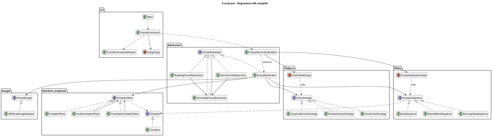

# FractaLens - A Fractal Generator Library Developed in Lens.

This project provides a *Java* library for generating fractal images.
It allows users to choose from a variety of complex sequences, including the
Julia set, Mandelbrot set, and other generalized sequences, to create
static or animated fractal images using different color palettes and
transformations.

## Command-line interface (Sprint 7)

Java 25 is required. Arguments are parsed by **Picocli 4.7.6**; `Main` delegates
to `FractalCommand`, which validates the settings and configures the existing
`FractalGeneratorBuilder`. No source change is needed between executions.

On Windows (PowerShell):

```powershell
.\gradlew.bat installDist
$env:JAVA_HOME = 'C:\Program Files\Eclipse Adoptium\jdk-25.0.2.10-hotspot' # adapt to your JDK 25 location
.\build\install\fractalens\bin\fractalens.bat --help
```

Alternatively, `./gradlew run --args="--help"` uses the configured Java 25
toolchain even when the terminal's default Java runtime is older.

On Linux/macOS, use `./gradlew installDist` and
`./build/install/fractalens/bin/fractalens --help`.
Running without arguments displays the full English help without generating
an image. Invalid arguments also display English help. `-h` means height;
use `--help` for help. Enum names are case-insensitive through `Main`.

| Option | Meaning | Default |
|---|---|---|
| `-f`, `--fractal-name` | A `ComplexSequenceType` name | `MANDELBROT` |
| `-h`, `--height` | Image height in pixels | `600` |
| `-w`, `--width` | Image width in pixels | `800` |
| `-s`, `--scale` | Complex distance between pixels; smaller means closer | `0.005` |
| `-x`, `--focus-x` | Real coordinate of the image center | `0` |
| `-y`, `--focus-y` | Imaginary coordinate of the image center | `0` |
| `-n`, `--nb-iterations` | Maximum iterations per pixel | `100` |
| `-p`, `--palette-name` | `GRAY`, `COMPONENT`, `GRADIENT`, `FIXED`, `INVERTED` | `GRAY` |
| `-t`, `--type` | `SINGLE`, `ZOOM`, `ROTATION` | `SINGLE` |
| `-o`, `--output` | Output path, with an image extension | `fractal.png` or `fractal.gif` for animations |
| `-i`, `--image-count` | Number of GIF frames | `50` |
| `--zoom-ratio` | Scale multiplier between zoom frames, strictly between 0 and 1 | `0.92` |
| `--frame-delay` | GIF frame duration in milliseconds, at least 10 | `80` |
| `--help` | Show all options and supported enum values | |

Dimensions and iteration counts must be positive; coordinates and scale must
be finite. Animation output must end in `.gif`. Exit codes are `0` for success
or help, `2` for invalid usage, and `1` for generation or output failures.

### Generate every predefined fractal from the command line

This PowerShell loop generates all ten sequences with every required image
parameter specified explicitly:

```powershell
$fractals = 'JULIA1','JULIA2','MANDELBROT','MULTIBROT','MULTIJULIA','MULTIJULIA2','BURNINGSHIP','MULTIBURNINGSHIP','TRICORN','MULTITRICORN'
foreach ($fractal in $fractals) {
    .\build\install\fractalens\bin\fractalens.bat -f $fractal -w 800 -h 600 -s 0.005 -x 0 -y 0 -n 150 -p GRADIENT -t SINGLE -o "$fractal.png"
}
```

### Animated examples

```powershell
.\build\install\fractalens\bin\fractalens.bat -f MANDELBROT -w 800 -h 600 -s 0.005 -x -0.75 -y 0.1 -n 150 -p GRADIENT -t ZOOM -i 60 --zoom-ratio 0.96 --frame-delay 80 -o mandelbrot_zoom.gif
.\build\install\fractalens\bin\fractalens.bat -f JULIA1 -w 800 -h 600 -s 0.005 -x 0 -y 0 -n 150 -p FIXED -t ROTATION -i 60 --frame-delay 80 -o julia_rotation.gif
.\build\install\fractalens\bin\fractalens.bat -f TRICORN -w 800 -h 600 -s 0.005 -x 0 -y 0 -n 150 -p INVERTED -t ROTATION -i 60 --frame-delay 80 -o tricorn_rotation.gif
```

Julia rotations vary the complex constant on a circle of radius `0.7885`,
preserving the power of MultiJulia variants. Other sequences rotate their
sampling plane about the requested focus. The selected fractal is preserved.
GIF frames are generated and encoded one at a time.

### Tests, coverage, Javadoc and SonarQube

```powershell
.\gradlew.bat check javadoc
.\gradlew.bat sonar -Dsonar.qualitygate.wait=true
```

`check` fails if total **line coverage is below 80%**. JaCoCo publishes HTML
and XML reports under `build/reports/jacoco/test/`. Test results are available
under `build/reports/tests/test/`, and the English Javadoc, including authors,
under `build/docs/javadoc/`.

The SonarQube plugin is `7.5.0.8588`, with server
`https://sonarqube.univ-artois.fr` and project key `fractalensLGMA`. The `sonar`
task runs tests and produces the JaCoCo XML before analysis. Configure a valid
`SONAR_TOKEN` environment variable locally; never commit a token. A successful
local build is separate from the remote SonarQube Quality Gate. The analysis
attempt without credentials returned HTTP 401; authenticated server results
must still be checked.

### Contribution attribution

Class-level `@author` entries follow the implementation and test-owner columns
of the feature table below. Where parsing and execution share a class, both
roles are recorded. Original credits to Romain Wallon for the supplied interfaces
and package skeletons are retained. These entries document the responsibilities
recorded by the team; they do not replace the Git history.

## Overview
## Diagramme UML


```plantuml
hide empty members

' --------------- '
' Complex Numbers '
' --------------- '

interface IComplex {
    + {abstract} getRealPart() : double
    + {abstract} getImaginaryPart() : double
    + {abstract} abs() : double
    + {abstract} negate() : IComplex
    + {abstract} conjugate() : IComplex
    + {abstract} add(other : IComplex) : IComplex
    + {abstract} subtract(other : IComplex) : IComplex
    + {abstract} multiply(value : double) : IComplex
    + {abstract} multiply(other : IComplex) : IComplex
    + {abstract} divide(other : IComplex) : IComplex
}

interface IComplexPlane {
    + {abstract} asComplex(row : int, column : int) : IComplex
}

IComplexPlane --> IComplex : << creates >>

' ----------------- '
' Complex Sequences '
' ----------------- '

interface IComplexSequence extends Iterable<IComplex> {
    + {abstract} computeNext(previous : IComplex) : IComplex
    + {abstract} iterator() : Iterator<IComplex>
}

IComplexSequence --> IComplex : << generates >>

' -------------- '
' Image Handling '
' -------------- '

interface IFractalImage {
    + {abstract} getHeight() : int
    + {abstract} getWidth() : int
    + {abstract} setColor(row : int, column : int, color : Color) : void
    + {abstract} saveAs(path : String) : void
}

' ------------------ '
' Fractal Generation '
' ------------------ '

interface IFractalGenerator {
    + {abstract} generateImage() : IFractalImage
    + {abstract} computePixelColor(row : int, column : int) : Color
    + {abstract} saveImage() : void
}

IFractalGenerator --> IFractalImage : << produces >>
IFractalGenerator --> IComplexSequence : << uses >>
```

## Feature list
| Feature | Design pattern(s) | Implementation ticket owner | Test ticket owner | Issue(s) |
|---|---|---|---|---|
| Complex number operations and `IComplex` | — | RM | RM | [#1](https://gitlab.univ-artois.fr/lylian_michel/fractalens/-/work_items/1), [#2](https://gitlab.univ-artois.fr/lylian_michel/fractalens/-/work_items/2), [#3](https://gitlab.univ-artois.fr/lylian_michel/fractalens/-/work_items/3), [#4](https://gitlab.univ-artois.fr/lylian_michel/fractalens/-/work_items/4), [#26](https://gitlab.univ-artois.fr/lylian_michel/fractalens/-/work_items/26), [#51](https://gitlab.univ-artois.fr/lylian_michel/fractalens/-/work_items/51), [#60](https://gitlab.univ-artois.fr/lylian_michel/fractalens/-/work_items/60) |
| Default complex plane | — | DA | DA | [#5](https://gitlab.univ-artois.fr/lylian_michel/fractalens/-/work_items/5), [#6](https://gitlab.univ-artois.fr/lylian_michel/fractalens/-/work_items/6), [#7](https://gitlab.univ-artois.fr/lylian_michel/fractalens/-/work_items/7), [#8](https://gitlab.univ-artois.fr/lylian_michel/fractalens/-/work_items/8) |
| Scaled complex plane | Decorator | RM | TG | [#27](https://gitlab.univ-artois.fr/lylian_michel/fractalens/-/work_items/27), [#33](https://gitlab.univ-artois.fr/lylian_michel/fractalens/-/work_items/33) |
| Translated complex plane | Decorator | RM | TG | [#39](https://gitlab.univ-artois.fr/lylian_michel/fractalens/-/work_items/39), [#44](https://gitlab.univ-artois.fr/lylian_michel/fractalens/-/work_items/44) |
| Complex sequence abstraction | Iterator | TG | TG | [#9](https://gitlab.univ-artois.fr/lylian_michel/fractalens/-/work_items/9), [#10](https://gitlab.univ-artois.fr/lylian_michel/fractalens/-/work_items/10), [#11](https://gitlab.univ-artois.fr/lylian_michel/fractalens/-/work_items/11), [#12](https://gitlab.univ-artois.fr/lylian_michel/fractalens/-/work_items/12), [#13](https://gitlab.univ-artois.fr/lylian_michel/fractalens/-/work_items/13), [#14](https://gitlab.univ-artois.fr/lylian_michel/fractalens/-/work_items/14) |
| Complex sequence iterator | Iterator | ML | ML | [#15](https://gitlab.univ-artois.fr/lylian_michel/fractalens/-/work_items/15), [#16](https://gitlab.univ-artois.fr/lylian_michel/fractalens/-/work_items/16), [#17](https://gitlab.univ-artois.fr/lylian_michel/fractalens/-/work_items/17), [#18](https://gitlab.univ-artois.fr/lylian_michel/fractalens/-/work_items/18), [#19](https://gitlab.univ-artois.fr/lylian_michel/fractalens/-/work_items/19), [#20](https://gitlab.univ-artois.fr/lylian_michel/fractalens/-/work_items/20), [#21](https://gitlab.univ-artois.fr/lylian_michel/fractalens/-/work_items/21), [#22](https://gitlab.univ-artois.fr/lylian_michel/fractalens/-/work_items/22), [#23](https://gitlab.univ-artois.fr/lylian_michel/fractalens/-/work_items/23) |
| Julia sequence | Iterator | TG (initial README) | — | [#9](https://gitlab.univ-artois.fr/lylian_michel/fractalens/-/work_items/9), [#10](https://gitlab.univ-artois.fr/lylian_michel/fractalens/-/work_items/10), [#11](https://gitlab.univ-artois.fr/lylian_michel/fractalens/-/work_items/11), [#14](https://gitlab.univ-artois.fr/lylian_michel/fractalens/-/work_items/14) |
| Mandelbrot sequence | Iterator | RM | RM | [#52](https://gitlab.univ-artois.fr/lylian_michel/fractalens/-/work_items/52) |
| Multi-Julia sequence | Iterator | TG | TG | [#53](https://gitlab.univ-artois.fr/lylian_michel/fractalens/-/work_items/53) |
| Multibrot sequence | Iterator | TG | TG | [#54](https://gitlab.univ-artois.fr/lylian_michel/fractalens/-/work_items/54) |
| Burning Ship sequence | Iterator | DA | DA | [#55](https://gitlab.univ-artois.fr/lylian_michel/fractalens/-/work_items/55) |
| Multi-Burning Ship sequence | Iterator | DA | DA | [#56](https://gitlab.univ-artois.fr/lylian_michel/fractalens/-/work_items/56) |
| Tricorn sequence | Iterator | ML | ML | [#57](https://gitlab.univ-artois.fr/lylian_michel/fractalens/-/work_items/57) |
| Multi-Tricorn sequence | Iterator | ML | ML | [#58](https://gitlab.univ-artois.fr/lylian_michel/fractalens/-/work_items/58) |
| Generic complex sequence | Strategy / function | RM | RM | [#59](https://gitlab.univ-artois.fr/lylian_michel/fractalens/-/work_items/59) |
| Predefined complex sequence types | Factory (functional) | RM | RM | [#63](https://gitlab.univ-artois.fr/lylian_michel/fractalens/-/work_items/63) |
| Color strategy abstraction | Strategy | RM | — | [#28](https://gitlab.univ-artois.fr/lylian_michel/fractalens/-/work_items/28) |
| Grayscale palette | Strategy | DA | TG | [#29](https://gitlab.univ-artois.fr/lylian_michel/fractalens/-/work_items/29), [#34](https://gitlab.univ-artois.fr/lylian_michel/fractalens/-/work_items/34) |
| Color component / RGB decorator | Decorator | DA; RM (related interface) | ML | [#37](https://gitlab.univ-artois.fr/lylian_michel/fractalens/-/work_items/37), [#40](https://gitlab.univ-artois.fr/lylian_michel/fractalens/-/work_items/40), [#45](https://gitlab.univ-artois.fr/lylian_michel/fractalens/-/work_items/45) |
| Inverted color palette | Decorator | RM | ML | [#41](https://gitlab.univ-artois.fr/lylian_michel/fractalens/-/work_items/41), [#46](https://gitlab.univ-artois.fr/lylian_michel/fractalens/-/work_items/46) |
| Gradient color palette | Strategy | DA | ML | [#42](https://gitlab.univ-artois.fr/lylian_michel/fractalens/-/work_items/42), [#47](https://gitlab.univ-artois.fr/lylian_michel/fractalens/-/work_items/47) |
| Fixed color strategy | Strategy | TG | ML | [#43](https://gitlab.univ-artois.fr/lylian_michel/fractalens/-/work_items/43), [#48](https://gitlab.univ-artois.fr/lylian_michel/fractalens/-/work_items/48) |
| Predefined color palette types | Factory / Strategy | DA | DA | [#64](https://gitlab.univ-artois.fr/lylian_michel/fractalens/-/work_items/64) |
| `BufferedImage` adapter | Adapter | DA | ML | [#30](https://gitlab.univ-artois.fr/lylian_michel/fractalens/-/work_items/30), [#35](https://gitlab.univ-artois.fr/lylian_michel/fractalens/-/work_items/35) |
| Static fractal generation | Strategy | TG | ML | [#31](https://gitlab.univ-artois.fr/lylian_michel/fractalens/-/work_items/31), [#36](https://gitlab.univ-artois.fr/lylian_michel/fractalens/-/work_items/36) |
| Fractal generator configuration | Builder | ML | ML | [#65](https://gitlab.univ-artois.fr/lylian_michel/fractalens/-/work_items/65), [#71](https://gitlab.univ-artois.fr/lylian_michel/fractalens/-/work_items/71) |
| GIF animation composite | Composite | RM | RM | [#68](https://gitlab.univ-artois.fr/lylian_michel/fractalens/-/work_items/68) |
| Scale-based animated generation | Composite | DA | DA | [#69](https://gitlab.univ-artois.fr/lylian_michel/fractalens/-/work_items/69) |
| Rotation-based animated generation | Composite | TG | TG | [#70](https://gitlab.univ-artois.fr/lylian_michel/fractalens/-/work_items/70) |
| Application entry point (`Main`) | — | ML | ML | [#32](https://gitlab.univ-artois.fr/lylian_michel/fractalens/-/work_items/32), [#50](https://gitlab.univ-artois.fr/lylian_michel/fractalens/-/work_items/50), [#62](https://gitlab.univ-artois.fr/lylian_michel/fractalens/-/work_items/62), [#66](https://gitlab.univ-artois.fr/lylian_michel/fractalens/-/work_items/66), [#72](https://gitlab.univ-artois.fr/lylian_michel/fractalens/-/work_items/72), [#77](https://gitlab.univ-artois.fr/lylian_michel/fractalens/-/work_items/77) |
| Command-line argument handling (Sprint 7) | CLI (library-based) | RM   | RM   | [#74](https://gitlab.univ-artois.fr/lylian_michel/fractalens/-/work_items/74) |
| Command-line validation (Sprint 7) | — | TG  | TG   | [#75](https://gitlab.univ-artois.fr/lylian_michel/fractalens/-/work_items/75) |
| Command-line execution (Sprint 7) | — | DA  | DA   | [#76](https://gitlab.univ-artois.fr/lylian_michel/fractalens/-/work_items/76) |
| CLI integration and README (Sprint 7) | — | ML   | ML   | [#77](https://gitlab.univ-artois.fr/lylian_michel/fractalens/-/work_items/77) |
## Team

This project has been developed by:

- Michel Lylian ML
- Royon Maxence RM
- Demey Alice DA
- Tinchon Gautier TG
